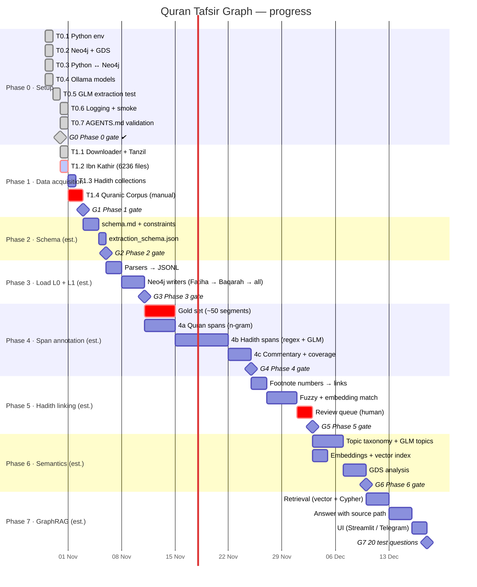

# Project timeline (Gantt)

Live progress view. Ticket detail and status: `docs/tickets/TRACKER.md` (source of truth).
Claude updates this file whenever a ticket changes status.

**Legend:** green/grey = done · blue = in progress · red = waiting for Aya & Mohamed · hatched future bars = **estimates**
(re-planned at the start of each phase, when its tickets are written).

## Progress summary
| Phase | Tickets done | Status | Gate |
|---|---|---|---|
| 0 · Setup | 7 / 7 | ✅ done | G0 signed off 2026-10-31 |
| 1 · Data acquisition | 1 / 4 | 🔴 T1.2 waiting for your test approval | — |
| 2 · Schema | 0 | ⏳ not started | — |
| 3 · Load L0 + L1 | 0 | ⏳ | — |
| 4 · Span annotation | 0 | ⏳ | — |
| 5 · Hadith linking | 0 | ⏳ | — |
| 6 · Semantics | 0 | ⏳ | — |
| 7 · GraphRAG | 0 | ⏳ | — |

## Waiting on Aya & Mohamed
- T1.4: download the Quranic Corpus morphology file (email form) → `data\raw\quranic-corpus\`.
- Plan updates (segment range ID, FOOTNOTE, NFC rule); `Citation` vs `HadithSpan`; review the T0.5 fixture.
- Approval of each ticket after its test scenarios.

## How to view
- **GitHub:** open `docs/GANTT.md` in the repo — the chart renders automatically.
- **VS Code:** Markdown preview (`Ctrl+Shift+V`) with a Mermaid extension (e.g. "Markdown Preview Mermaid Support").
- **Anywhere:** paste the `mermaid` block into https://mermaid.live.
